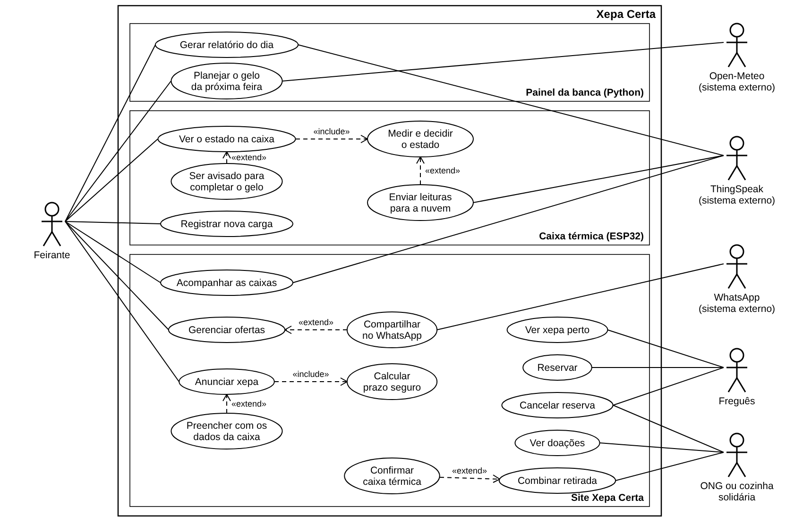
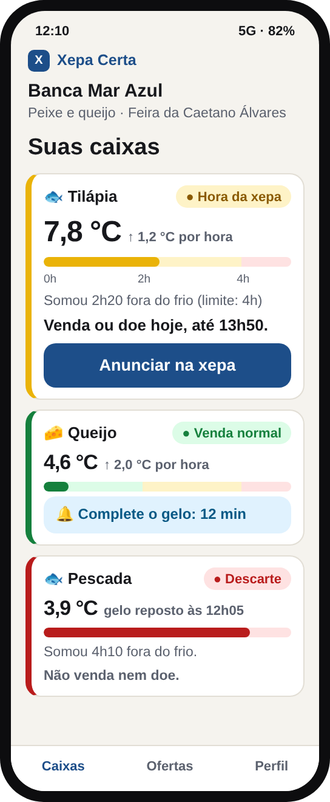
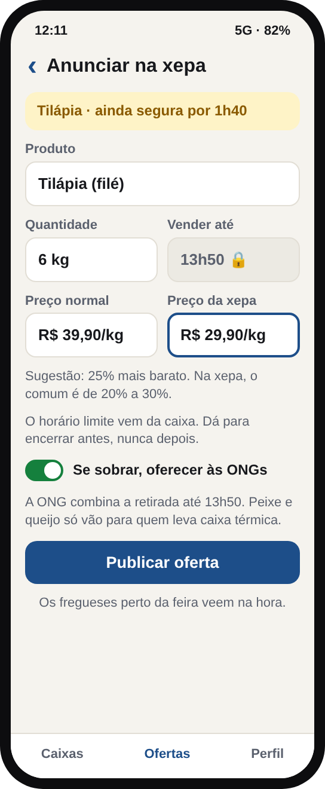
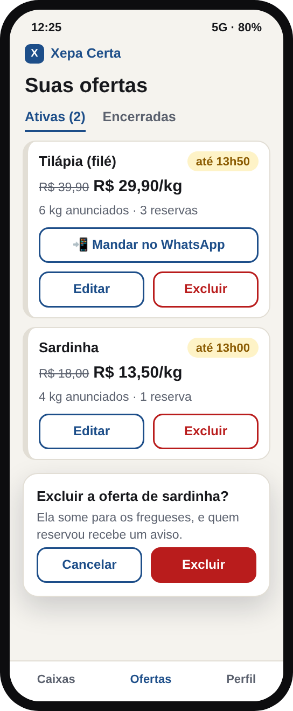
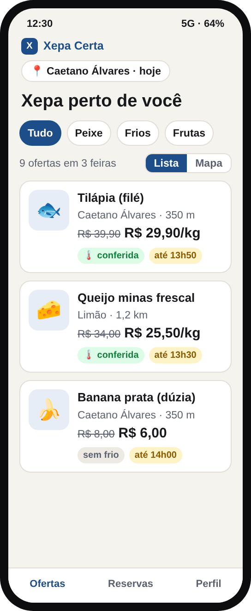
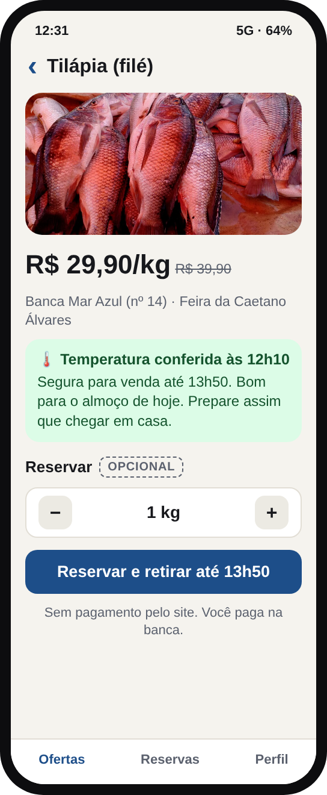
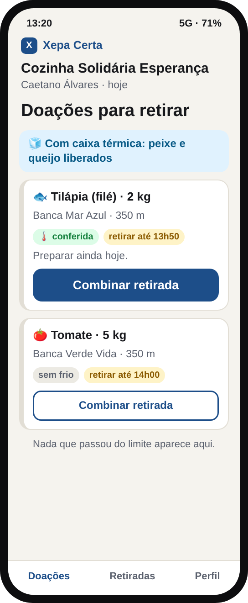

# Experiência do usuário · Xepa Certa

Material de Software & Total Experience Design da Xepa Certa: problema, escopo, requisitos, regras de negócio, caso de uso, protótipo, heurísticas, tom de voz e próximos passos.

GS CitizenTech 2026.2 · Engenharia de Software, 1º ano · Software & Total Experience Design · time SafeTech

- Slides: https://claude.ai/artifact/HGVpWbd8XccSdwJDw1deNr

Integrantes:

- Pedro Thyago de Araújo Santos, RM 570939
- Pedro Passos Corsini, RM 573493
- Daniel Gomes Torres, RM 573436
- Henrique Lira, RM 571009

## Ficha da CitizenTech

- **Nome:** Xepa Certa
- **Cidade e bairro:** São Paulo, Zona Norte, feira de domingo da Av. Engenheiro Caetano Álvares
- **Cidadão:** o feirante de perecível (peixe, queijo e frios), os fregueses do bairro e as ONGs e cozinhas solidárias da região
- **Problema em uma frase:** o feirante não tem como saber se o peixe e o queijo ficaram frios o suficiente, perde mercadoria quando o gelo acaba antes do esperado, e a sobra boa não chega a tempo a quem precisa.
- **Como funciona:** um sensor na caixa térmica mede a temperatura e soma o tempo fora do frio. A caixa mostra verde, amarelo ou vermelho mesmo sem internet. No amarelo, o feirante anuncia a xepa no site e fregueses e ONGs reservam. No vermelho, o produto sai da venda.
- **Indicador:** quilos de perecível que deixaram de ir para o lixo por feira (vendidos na xepa ou doados) e reais de perda evitada por feirante.
- **ODS:** 2 (meta 2.1, acesso a alimento), 3 (metas 3.3 e 3.d, saúde e alerta de risco) e 11 (meta 11.6, menos resíduo na cidade).

O que cada matéria entrega:

- Edge Computing: a caixa térmica com sensor ([repositório](https://github.com/citizentech-1ESPU/edge-computing-and-computer-systems))
- Front-end e Web Development: o site da xepa ([repositório](https://github.com/citizentech-1ESPU/web_development))
- Python: o painel da banca ([repositório](https://github.com/citizentech-1ESPU/computational-thinking-with-python))
- Matemática: o modelo de quanto o gelo dura ([repositório](https://github.com/citizentech-1ESPU/differentiated-problem-solving))
- STED: requisitos, jornada e protótipo ([repositório](https://github.com/citizentech-1ESPU/software-and-total-experience-design))
- Pitch: a história do projeto em 3 minutos

## O problema

Na feira de domingo da Av. Eng. Caetano Álvares, na Zona Norte de São Paulo, o gelo das caixas de peixe e queijo derrete perto do meio-dia e o feirante só percebe tarde. Ele joga fora o que deixa dúvida, a xepa acontece no improviso e a doação não chega a quem precisa, porque ninguém combina a retirada.

## A solução

- **Caixa térmica com sensor:** mede a temperatura, soma o tempo fora do frio e avisa com luz, som e display, mesmo sem internet.
- **Site:** o feirante anuncia a xepa em poucos toques, o freguês reserva e a ONG combina a retirada da doação.
- **Painel da banca:** relatório do dia e quanto gelo levar na próxima feira.

## Caso de uso

Atores: feirante, freguês e ONG ou cozinha solidária. Sistemas externos: ThingSpeak, WhatsApp e Open-Meteo. A caixa térmica é parte do sistema, por isso aparece dentro dele e não como ator.

## Protótipo

Fluxo do feirante: ver as caixas, anunciar a xepa e gerenciar as ofertas.

  

Fluxo do freguês e da ONG: ver as ofertas perto, reservar e combinar a retirada.

  

A foto da tilápia na tela 5 é de Michaelphoya, Wikimedia Commons, licença CC BY-SA 4.0.

## Requisitos e regras

Os slides trazem 16 requisitos funcionais, 8 não funcionais e 11 regras de negócio, cada um com classificação e justificativa, além da ligação de cada caso de uso com os requisitos que ele atende.

## Arquivos

- `imagens/caso-de-uso.png`: diagrama de caso de uso
- `imagens/tela1.png` a `imagens/tela6.png`: telas do protótipo
- `Xepa Certa · STED.pdf` e `Xepa Certa · STED.pptx`: os slides exportados
